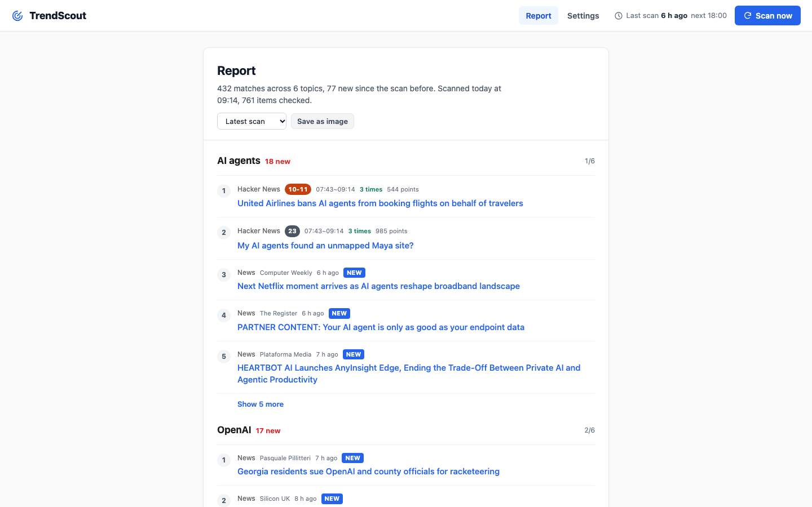
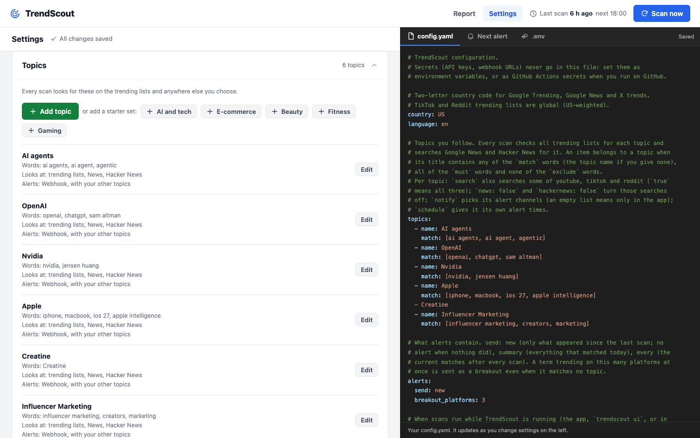

# TrendScout

[](https://github.com/scavio-ai/trendscout/actions/workflows/ci.yml) [](LICENSE) 

**An open-source trend radar for TikTok, YouTube, Reddit, Google, X and the news.** Tell it the topics you care about. It checks every trending list and the news on your schedule, and pings you on Telegram, Discord, Slack, email or your phone when something new shows up. Runs on your own computer or free on GitHub Actions.

**See it live: [trends.scavio.dev](https://trends.scavio.dev)**, what is trending right now on TikTok, Google, X, Reddit and Hacker News, rebuilt every 3 hours by this repo's own workflow.

Three ways to run it:

| | How | Good for |
|---|---|---|
| **On GitHub** | Fork, add a secret, enable Actions ([steps](#run-it-on-github-actions-no-computer-needed)) | Alerts and a public page without a computer |
| **On your computer** | `pip install trendscout-radar` then `trendscout ui` | Trying it, the app, the background scanner |
| **With Docker** | `docker build` and `docker run` ([steps](#keep-it-running)) | A home server or a small VPS |

[Quick start](#quick-start) &middot; [How alerts work](#how-alerts-work) &middot; [Sources](#sources) &middot; [What it costs](#what-it-costs) &middot; [Run it on GitHub](#run-it-on-github-actions-no-computer-needed) &middot; [Compared with](#compared-with)



## What you get

- **Your topics first.** Follow brands, products, people or hobbies. Every scan checks all the trending lists and the news for them, and shows the matches first. Everything else waits in a collapsed section.
- **Alerts only when something is new.** By default an alert lists only what appeared since the last scan, and no alert is sent when nothing did. Prefer a daily summary? One click.
- **When it started trending.** Each item shows where it ranks, how long it has been on the list and how many scans have seen it: "#2 to #8, on the list since 08:00, seen 4 times".
- **Trending on several platforms at once.** A term trending on Google that is also on X, Reddit or Hacker News is the strongest early signal there is. TrendScout spots them for you.
- **A real app, no YAML needed.** A setup wizard, a live preview of your next alert, a test button for every channel, and starter topic sets for AI, e-commerce, beauty, fitness and gaming.
- **Keeps working in the background.** On macOS and Linux it can start at login and keep scanning on your schedule.
- **Your data stays with you.** Plain JSON files on your disk (or in your GitHub repo). No database, no account with us.
- **A public trend page if you want one.** On GitHub Pages it publishes a page like [trends.scavio.dev](https://trends.scavio.dev), with an RSS feed, and leaves out anything with profanity or adult content.

## Compared with

| | TrendScout | [TrendRadar](https://github.com/sansan0/TrendRadar) | Exploding Topics | Glimpse |
|---|---|---|---|---|
| Open source | yes, MIT | yes, GPL-3.0 | no | no |
| Runs where | your computer, GitHub Actions, Docker | your computer, GitHub Actions, Docker | hosted service | browser extension and web app |
| Platforms | TikTok, YouTube, Reddit, Google, X, Hacker News, Google News | Chinese platforms (Weibo, Douyin, Zhihu, Baidu and more) | its own database of rising topics | Google Trends |
| Your own topics, pushed to your chat apps | yes | yes | no | no |

## Quick start

```bash
pip install trendscout-radar
trendscout ui
```

Your browser opens a short setup:

1. **Pick topics.** Choose a starter set or type your own.
2. **Add a Scavio key** for TikTok, YouTube, Reddit and X ([free key](https://scavio.dev/?utm_source=github&utm_medium=readme&utm_campaign=trendscout), 50 credits included), or skip it and use the free sources.
3. **Choose where alerts go.** Each channel has step-by-step instructions and a "Send a test" button.
4. **Choose how often to check** (morning and evening is the default) and what an alert contains.

The first scan runs right away and takes about a minute.



The app has two views:

| View | What it is for |
|---|---|
| **Report** | One page per scan: a one-line summary, then each topic with its numbered items. Every item shows the platform, its rank (red for top 5, orange for top 10), the time window it was on the list and how many scans saw it. Then terms trending on several platforms, everything else in a collapsed list, earlier scans, and "Save as image" for sharing. |
| **Settings** | Nine sections on the left (topics, added and edited in a popup that asks what to follow, which words count, what to leave out and which platforms to search, trending lists, where alerts go, what alerts contain, when to check with a week view, keys, AI briefing, region and spending, advanced). On the right, live as you edit: the `config.yaml` that saving would write, your next alert, and your `.env` with keys hidden. |

The app runs only on your computer (127.0.0.1). Keys you enter go to a `.env` file next to `config.yaml` that only your user can read, and the browser never sees them again. The link the app opens carries a private token kept next to your config, so other websites in your browser cannot use it.

## How alerts work

After each scan TrendScout matches everything it collected against your topics and decides what to send:

| Alert style | Sends | Good for |
|---|---|---|
| **Only what is new** (default) | Items first seen in this scan. Nothing at all when there are none. | Frequent scans without noise |
| **A summary of today** | Everything that matched since midnight | Morning and evening scans |
| **Every scan** | The current matches, new or not | A steady feed |

Each line reads like this:

```
AI agents: 18 new
  1. [Hacker News] United Airlines bans AI agents from booking flights [#10-#11] - [07:43 ~ 09:14] (seen 3 times)
  2. [News] Next Netflix moment arrives as AI agents reshape broadband - Computer Weekly, 4 min ago NEW
```

Each topic can have its own alert channels and its own alert times (for example Skincare to a client's Slack at 09:00 on weekdays, AI to your Telegram every hour). New topics start with your usual channels and schedule. TrendScout scans at the combined times, and a topic's alert covers everything that showed up since its last alert.

On top of your topics, a term trending on 3 or more platforms at once is sent as a breakout (you can set 2 to 5). Each alert leads with your topics, gives every item a link and one line of context, and fits the channel's size limit by dropping whole lines ("and 12 more"), never by cutting a topic in half.

A topic matches an item when the title contains any of its words (the topic name if you set none), all of its "must include" words and none of its "leave out" words, as whole words. So `AI` matches "Is AI coming for your job?" but not "email".

## Sources

| Source | What it returns | Needs a key | Scavio credits per scan |
|---|---|---|---|
| TikTok trending searches | ~90 search terms trending on TikTok | yes | 1 |
| TikTok trending videos | A sample of trending videos with views | yes | 1 per call (2 by default) |
| TikTok viral sounds | The Viral 50 sound chart | yes | 1 |
| Google Trending Now | Trending searches for your country, with volume | free without a key (RSS) | 1 |
| X trending | Trending topics for your country | yes | 1 |
| Reddit popular | The r/popular front page | yes | 1 |
| Reddit trending searches | Reddit's trending queries (often empty, off by default) | yes | 1 |
| Hacker News | Top stories with points | no | free |
| **For every topic:** Google News | Articles from the last two days | no | free |
| **For every topic:** Hacker News | Discussions from the last 7 days with at least 5 points | no | free |
| **Per topic, if you pick them:** YouTube, TikTok, Reddit | The week's most-viewed videos, the most-liked TikToks of the last 7 days, threads from the last 30 days | yes | YouTube 2, TikTok 1, Reddit 1 |

Why a key for TikTok, Reddit and X? None of them has a free public API that works from a server: Reddit's public JSON answers `403` to scripts, and TikTok and X have no open trend endpoints. TrendScout uses [Scavio](https://scavio.dev/?utm_source=github&utm_medium=readme&utm_campaign=trendscout) for those, one key for all of them. The free sources always run, key or not.

## What it costs

- **No key:** free. Google Trends, the Hacker News front page, and a Google News and Hacker News search for every topic.
- **With a Scavio key:** about **7 credits per scan** with the defaults, whatever the number of topics, because topics are matched for free. Searching YouTube, TikTok or Reddit for a topic adds 2, 1 or 1 credits per scan. Morning and evening scans come to about 420 credits a month. `trendscout check` prints the exact cost for your settings, and `max_credits_per_run` in `config.yaml` is a hard cap per scan.
  - Sign-up includes 50 free credits, about 7 scans.
  - More free credits: the *Earn Credits* card on the Scavio dashboard (starring a repo, sharing, or a review).
  - Paid plans start at $15/month for 3,000 credits: enough for a scan every 3 hours, or morning and evening with 5 searched topics.
- **AI briefing:** whatever your model provider charges for one short prompt per scan. Optional.

## Keep it running

- **In the background (macOS, Linux):** turn on "Keep checking when TrendScout is closed" on the Alerts page, or run `trendscout background on`. It starts at login and scans on your schedule. `trendscout background off` removes it. Background processes cannot see keys exported in your shell profile, so save keys in the app.
- **With Docker:**
  ```bash
  docker build -t trendscout .
  mkdir -p radar && cp config.yaml radar/
  docker run -d --name trendscout --env-file .env -v "$PWD/radar:/radar" -p 127.0.0.1:8765:8765 trendscout
  docker logs trendscout   # prints the link to the app
  ```
  The container runs the app and scans on the schedule in `radar/config.yaml`. History and reports land in `./radar`.

## Run it on GitHub Actions (no computer needed)

1. **Fork this repo.**
2. **Add your key.** In your fork: *Settings, Secrets and variables, Actions, New repository secret*, name `SCAVIO_API_KEY`. No key? Skip this and the free sources run.
3. **Add a channel.** Add the secrets for one channel, for example `TELEGRAM_BOT_TOKEN` and `TELEGRAM_CHAT_ID` ([all channels](#alert-channels)).
4. **Pick your topics** by editing `topics:` in `config.yaml` in your fork.
5. **Turn it on.** Open the *Actions* tab, enable workflows, choose **radar**, click **Run workflow**.

It then runs every day at 13:17 UTC; change the cron line in `.github/workflows/radar.yml` for another schedule. History is committed to a `radar-data` branch of your fork.

**Publish a report page:** add a repository variable `PAGES` = `true` and set *Settings, Pages, Source* to *GitHub Actions*. Your report appears at `https://<you>.github.io/trendscout/`, and alerts link to it. Using your own domain? Set it under *Settings, Pages* and add a variable `SITE_URL` with the full address.

The page is built to be shared and found:

- A title, description and preview image for search results and link previews, plus structured data (the ranked lists and a short FAQ answered from the live data).
- `feed.xml` (RSS), `sitemap.xml` and `robots.txt`. Earlier updates stay linked at the bottom but are marked `noindex`, so search engines only see the current page.
- Items with profanity or adult content (a short built-in word list, plus posts Reddit marks NSFW) are left out of the page, its JSON and its feed. Add your own words with `site_exclude` in `config.yaml`. The app and the files in `reports/` still show everything.

**Scan every 3 hours:** add a variable `SCAN_EVERY_3_HOURS` = `true`. That is 8 scans a day, about 56 credits a day with the defaults.

## Alert channels

The app sets these up for you. On GitHub, or to configure by hand, set these secrets or environment variables. Each channel is optional, and a failing channel never blocks the others.

| Channel | Variables |
|---|---|
| Telegram | `TELEGRAM_BOT_TOKEN`, `TELEGRAM_CHAT_ID` |
| Discord | `DISCORD_WEBHOOK_URL` |
| Slack | `SLACK_WEBHOOK_URL` |
| Phone (ntfy) | `NTFY_TOPIC`, optional `NTFY_SERVER` |
| Email | `SMTP_HOST`, `SMTP_PORT`, `SMTP_USER`, `SMTP_PASSWORD`, `EMAIL_FROM`, `EMAIL_TO` |
| Webhook | `WEBHOOK_URL` (receives the alert and the full report as JSON) |
| AI briefing | `LLM_API_KEY` and `LLM_MODEL` (e.g. `gpt-5.5`), optional `LLM_BASE_URL` for OpenRouter, Ollama or any OpenAI-compatible endpoint |

## Configuration file

The app writes [`config.yaml`](config.yaml) for you and keeps its comments. To edit it by hand:

```yaml
topics:
  - name: Skincare
    match: [skincare, skin care, retinol]   # any of these words
    exclude: [giveaway]                     # never these
    search: [youtube, tiktok]               # also search these (+2, +1 credits); true = all three
    notify: [slack]                         # where its alerts go; [] = only in the app
    schedule: {at: ["09:00"], days: [mon, tue, wed, thu, fri]}   # its own alert times
  - Creatine                                # just a name works too
alerts:
  send: new                # new, summary or every
  breakout_platforms: 3
schedule:
  at: ["08:00", "18:00"]   # or: every: 3h
  days: [mon, tue, wed, thu, fri, sat, sun]
country: US
max_credits_per_run: 60    # hard stop per scan
```

## Command line

```bash
trendscout ui                  # the app
trendscout check               # every call a scan makes and its cost; spends nothing
trendscout run                 # one scan: collect, compare, write reports, send alerts
trendscout run --no-notify     # the same without sending anything
trendscout background on       # keep scanning when the app is closed (macOS, Linux)
```

Each scan also writes `reports/latest.md`, `reports/latest.json` and a static page in `site/` (with `feed.xml`, and `sitemap.xml` when `site_url` is set). `trendscout report` rebuilds them from the latest scan.

## Use it from an AI agent

[`skill/SKILL.md`](skill/SKILL.md) teaches Claude Code, Codex, OpenClaw and other agents to run a scan and read `reports/latest.json`, so you can ask "what is new in my niche today?" and get an answer grounded in fresh data.

## How it works

1. **Collect.** Each source is called once, one request at a time. A failing source is logged and skipped; an out-of-credits error stops the paid calls and lets the free ones finish.
2. **Remember.** Every item goes into a timeline (`data/timeline.json`): when it was first and last seen, how many scans saw it, and its best and worst rank.
3. **Match.** Items are matched to your topics as whole words, and terms are matched across platforms, ignoring generic words like "trend" or "dance".
4. **Decide and deliver.** The alert style decides what is worth sending. Reports are written, and the alert goes to every channel you set up.

## Development

```bash
uv venv && uv pip install -e ".[dev]"
pytest
```

Tests run against real API responses captured in `tests/fixtures`, so the parsers are checked against actual field names. The app is plain HTML, CSS and JavaScript in `trendscout/ui/` with no build step; `trendscout/app.py` serves it with Python's standard library.

## Credits

The report card, the settings editor and the alert format are inspired by [TrendRadar](https://github.com/sansan0/TrendRadar), the open-source trend radar for Chinese platforms. TrendScout is a separate, MIT-licensed codebase for TikTok, YouTube, Reddit, Google, X and the news.

## License

MIT. Built by [Scavio](https://scavio.dev/?utm_source=github&utm_medium=readme&utm_campaign=trendscout), the web data API behind the TikTok, YouTube, Reddit and X sources. Issues and pull requests welcome, including new free sources.
